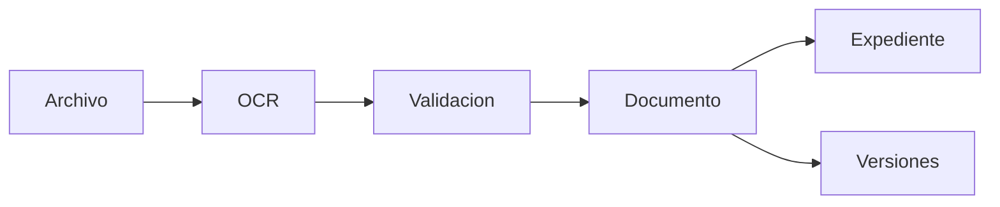

# Motor Documental

**Estado:** Aprobado  
**Responsable:** Maestro Sucesor I  

---

## Objetivo

El Motor Documental es la capacidad compartida encargada de transformar archivos en documentos de negocio.

---

## Conceptos

### Documento lógico

Entidad de negocio.

Ejemplos:

- Factura
- OC
- OS
- Guía
- Nota de ingreso
- Transferencia
- Detracción

### Archivo físico

Evidencia asociada a un documento lógico.

Ejemplos:

- PDF original
- PDF firmado
- escaneo
- imagen
- sustento

---

## Flujo

---

## Reglas

- Backend calcula clave documental.
- OCR propone, backend confirma.
- Nunca sobrescribir archivos.
- Duplicados generan propuesta de versión.
- Revisión Contable trabaja sobre documentos lógicos.

---

## Ver también

- `../motor-documental/README.md`
- `../11-adr/ADR-002-documento-logico.md`
- `../11-adr/ADR-006-estrategia-de-versionado-documental.md`

---

## 2026-11-25 — Cierre institucional documental NAS R1

Repository=SOURCE. Esta adenda prevalece únicamente sobre estados históricos incompatibles de NAS; no reescribe antecedentes ni autoriza acciones por su lectura.

SOURCE conserva excluidos los scripts locales de recuperación no rastreados.

### Contrato documental y nomenclatura vigente

Ruta común definitiva: `documentos/YYYY/MM/EMPRESA/NOMBRE.ext`, sin segmento CLIENTE. Resolver periodo, empresa y nomenclatura una sola vez desde el dominio y PostgreSQL; nunca fecha del servidor como fallback contable. Nuevos documentos materializados en R2 con ruta definitiva antes del commit final cuando su identidad se conoce al confirmar; reserva durable y compensaciones/exclusión existentes. Archivado postcommit recibe la ruta persistida y la conserva en NAS, sin recalcular periodo ni nombre. Históricos conservan su clave R2; regularización histórica masiva diferida. La compatibilidad histórica de nombre NAS no autoriza renombrar R2 ni es el camino ordinario nuevo.

| Variante aprobada | Nombre definitivo |
| --- | --- |
| OC / OS | `OC_NUMERO.pdf` / `OS_NUMERO.pdf` |
| Factura vinculada | `OC_NUMERO__FACTURA_SERIE-NUMERO_RUC.pdf` (principal OS u OP según dominio) |
| Guía OC/OS | `OC_NUMERO__GUIA_SERIE-NUMERO_RUC.pdf` (también OS) |
| NI OC/OS | `OC_NUMERO__NOTA_INGRESO_NUMERO.pdf` (también OS) |
| Orden de pago | `OP_NUMERO.pdf`, `.png` o `.jpg` según MIME admitido |
| RH de OP | `OP_NUMERO__RH_SERIE-NUMERO_RUC.pdf` |
| Sustento de transferencia OC/OS/OP | `OC_NUMERO__TRANSFERENCIA_BANCO_OPERACION.pdf` (también OS/OP) |
| Sustento de detracción OC/OS/OP | `OC_NUMERO__DETRACCION_BANCO_OPERACION.pdf` (también OS/OP) |
| Versiones existentes del dominio | V1 sin sufijo; V2/V3 conservan base autorizada y `__V2.ext` / `__V3.ext`; formatos admitidos PDF/PNG/JPEG según contrato |

Se conservan ceros y validación estricta de segmentos; no inventar variantes ni numeraciones. Banco normalizado y operación del dominio, no nombre original. Autoridad implementada: `apps/ms-documentos/src/documentos/archivado/archivado-nomenclatura.ts`.
Periodo ya vigente: OC/OS por emisión propia; factura OC/OS por factura; Guía/NI/sustento OC/OS por factura vinculada; OP y asociados por emisión OP; versiones conservan periodo original. No rediseñar el resolutor.

Confirmación → reserva/asociación durable → postcommit → copia R2 a staging NAS → publicación sin reemplazo → verificación de identidad/tamaño/SHA256 → disponibilidad NAS y auditoría → selección de proveedor del visor. Lease/CAS no cancela operaciones externas enviadas; preservar exclusión física, reserva permanente y reconciliación. Regularización ordinaria/manual/diaria reutiliza el mismo servicio; no crear otro scheduler. TEMP, OCR persistido, borrador y confirmación mantienen su contrato; recuperar no relanza OCR.
