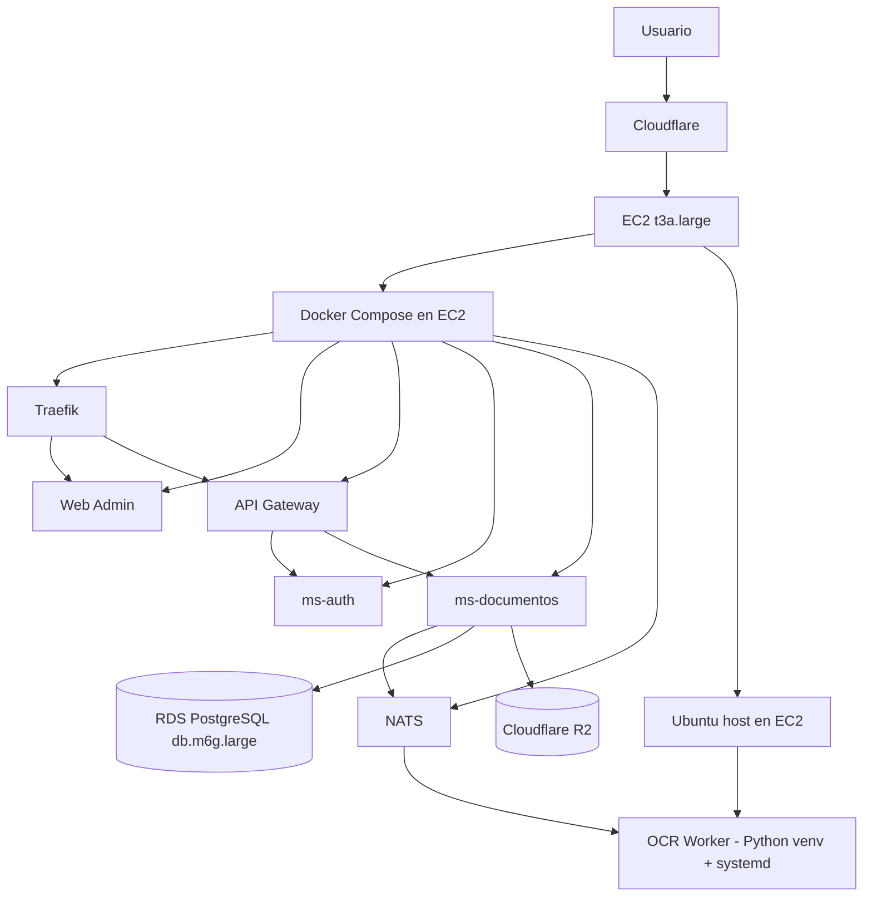

# Deployment AWS

## Referencias

- `../07-infraestructura/01-despliegue.md`
- `../07-infraestructura/02-docker.md`
- `../07-infraestructura/05-ocr-worker.md`
- `../18-runbooks/ocr-worker-host.md`
- `../29-operations-manual/11-deployment-readiness-checklist.md`

## Continuidad R2 — 23/10/2026

Fuente: paquete MSII `PAQUETE_CODEX_R2_DOCUMENTACION_INVENTARIO_2026-10-23.md` y actualización ME `ACTUALIZACION_BIBLIOTECARIO_TECNICO_R2_2026-10-23.md`, ambos en `/home/loxi1/Descargas/`. Producción R2 = **DEPLOY_TECHNICAL_PASS reportado por PO/MSII**; aceptación funcional integral = **PENDING**, E2E = **NOT_VERIFIED**. Esta actualización documental no accedió a EC2/GHCR/RDS ni autoriza operaciones.

Commit Enterprise R2: `e1f099faeb4dfdc9f2b49b9984fe211935875ff3`. Ver [manifest vigente](../31-governance/RELEASE_MANIFEST.md), [deploy](../18-runbooks/DEPLOYMENT_RUNBOOK.md) y [rollback](../18-runbooks/ROLLBACK_RUNBOOK.md).

Los únicos servicios de aplicación recreados en R2 fueron api-gateway, ms-auth, ms-documentos y web-admin. NATS/Traefik permanecen en Docker; OCR en documental-ocr-worker.service, fuera de la recreación de aplicaciones.
